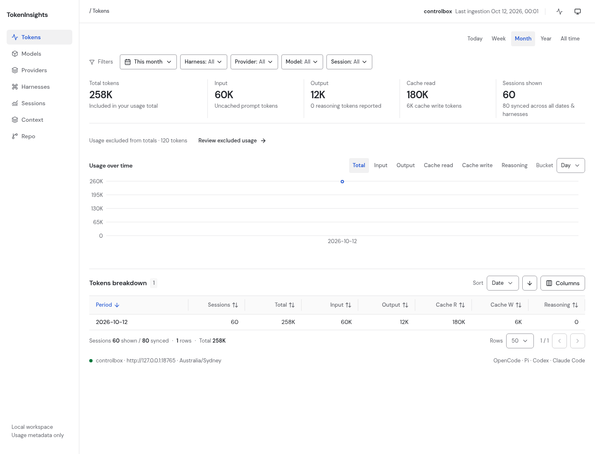
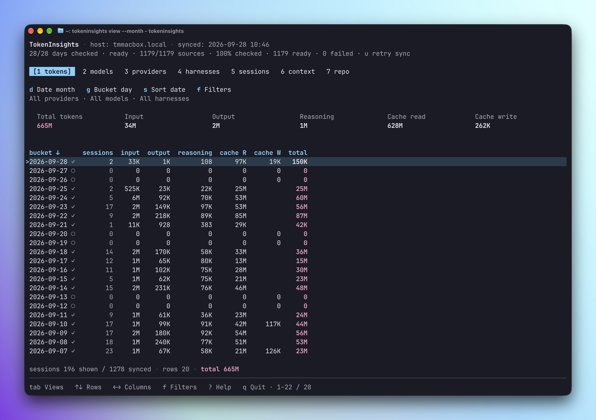

# TokenInsights

TokenInsights is a token usage dashboard for OpenCode, Pi, Codex, and Claude Code. A Go collector captures sanitized evidence in SQLite. Shared ingestion and processing store token data in SQLite inside local commands, or SQLite/PostgreSQL in an authenticated remote server.

| Web                                                                                  | TUI                                                                       |
| ------------------------------------------------------------------------------------ | ------------------------------------------------------------------------- |
|  |  |

## Quickstart

```sh
brew install flexdinesh/tap/tokeninsights
tokeninsights web
```

## Documentation

User guides live in [`docs-website/`](docs-website/README.md), a Vocs site. Run `pnpm run dev:docs` to serve them locally at `http://localhost:5173/`.

- [Overview](docs-website/src/pages/index.mdx)
- [Install](docs-website/src/pages/install.mdx): Homebrew, Go, and release channels.
- [Getting started](docs-website/src/pages/getting-started.mdx)
- [Local usage](docs-website/src/pages/local-usage.mdx): browser and terminal dashboards.
- [Commands](docs-website/src/pages/commands.mdx): viewers, sync, configuration, and maintenance.
- [Distributed sync](docs-website/src/pages/sync.mdx): collectors, jobs, and harness plugins.
- [Self-hosting](docs-website/src/pages/self-hosting.mdx): server, storage, users, and API keys.
- [Maintenance](docs-website/src/pages/maintenance.mdx): reprocessing, backups, and incompatible data.
- [Privacy and data](docs-website/src/pages/privacy.mdx)

Internal engineering docs remain in `docs/`.

[ADR 0009](docs/adr/0009-single-process-and-distributed-compositions.md) records the approved runtime composition; the [development guide](docs/development.md) defines verification gates.

- [CLI reference](packages/cli/README.md)
- [Development guide](docs/development.md)
- [Ingestion benchmarks and profiling](docs/ingestion-performance.md) — current SQLite/PostgreSQL workloads, benchmark smoke checks and profiling.
- [System boundaries](docs/system.md) and [storage/processing contract](docs/design.md)
- [Docker and hosted deployment](docs/deployment.md)
- [Architecture principles](docs/adr/0010-current-contracts-and-boundaries.md) — ownership, composition, current contracts and verification.
- [Storage adapter contracts](docs/adr/0011-storage-adapter-contracts.md) — backend interfaces and conformance tests.
- [SQLite/PostgreSQL persistence](docs/adr/0012-sqlite-and-postgres-persistence.md) — supported engines, ownership and schema contracts.
- [Hosted user management](docs/adr/0016-hosted-user-management.md) — password login, optional signup, browser sessions and API keys.
- [Collector/ingestion failure tests](docs/collector-ingestion-tests.md) — guarantees, synthetic fixtures, executable coverage, and future acceptance gates.
- [Completion plugins](docs/plugins.md) — thin completion hooks, install artifacts, and host verification scope.
