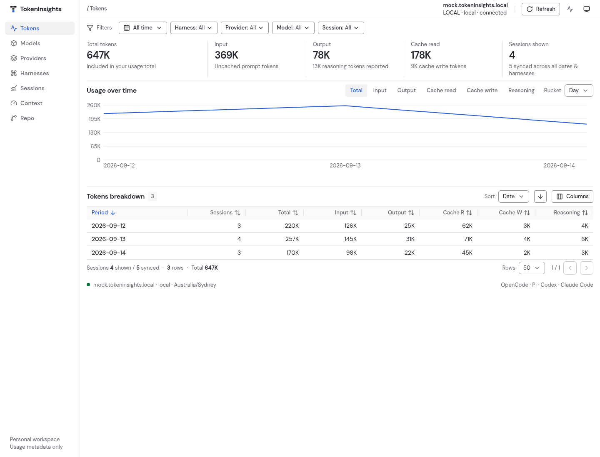
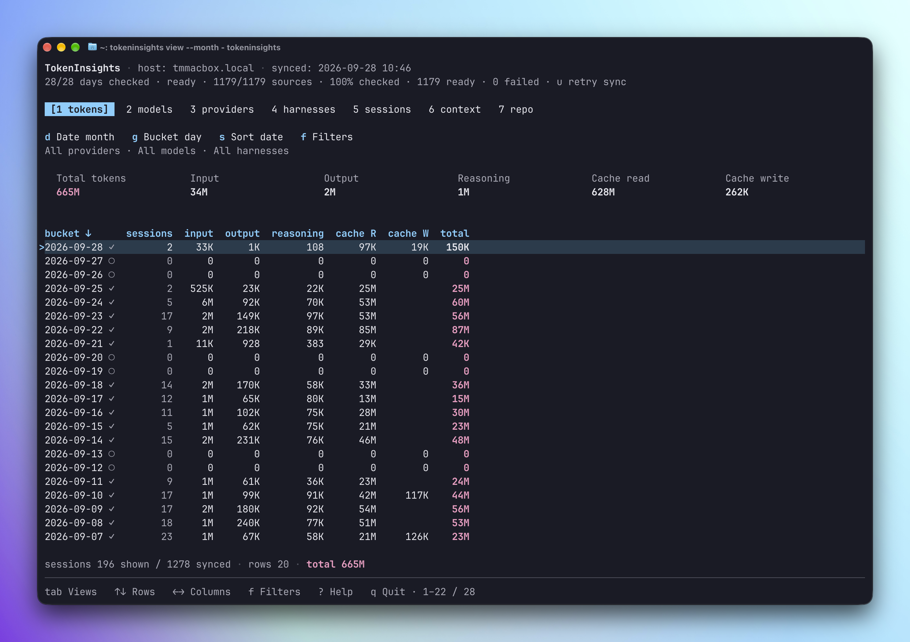

# TokenInsights

Local token usage dashboard for OpenCode, Pi, Codex, and Claude Code.

| Web                                                                                       | TUI                                                                                           |
| ----------------------------------------------------------------------------------------- | --------------------------------------------------------------------------------------------- |
|  |  |

## Install

macOS/Linux, amd64/arm64. Binaries go to `~/.local/bin`.

```sh
curl -fsSL https://raw.githubusercontent.com/flexdinesh/tokeninsights/main/install.sh | sh          # CLI, TUI, web
curl -fsSL https://raw.githubusercontent.com/flexdinesh/tokeninsights/main/install-mygo.sh | sh     # desktop app (experimental)
curl -fsSL https://raw.githubusercontent.com/flexdinesh/tokeninsights/main/install-electron.sh | sh # Electron desktop (experimental)
curl -fsSL https://raw.githubusercontent.com/flexdinesh/tokeninsights/main/install-server.sh | sh   # hosted server
```

Rerun to update. Latest `main` build: `install-main.sh`, or append `| sh -s -- --channel=main` to any script.

## Use

```sh
tokeninsights tui
tokeninsights web
tokeninsights tui --endpoint ssh://you@devbox
```

## Docs

- [CLI reference](docs/cli.md)
- [Development](docs/development.md)
- [User guides](docs-website/README.md)
- [Hosted deployment](docs/deployment.md)
- [Design](docs/design.md) and [ADRs](docs/adr/)

## License

[MIT](LICENSE)
