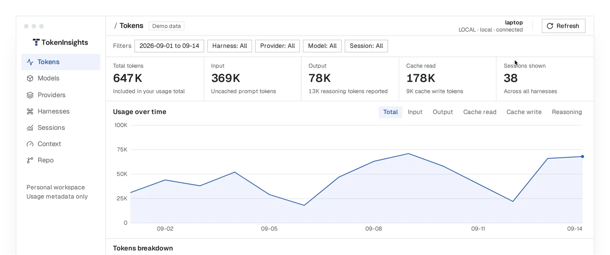

# <picture><source media="(prefers-color-scheme: dark)" srcset="assets/brand/lockup-dark.svg"></picture>

**Token usage for your coding agents.**

See where your tokens go across OpenCode, Pi, Codex and Claude Code, on your own machine.

<picture>
  <source media="(prefers-color-scheme: dark)" srcset="assets/readme/cover-dark.webp">
  
</picture>

[Website](https://tokeninsights.hoplabs.dev/) · [Docs](https://tokeninsights.hoplabs.dev/docs) · [Install](#quick-start)

TokenInsights reads the usage your agents already write to disk and turns it into one
dashboard: totals, trends and per-session detail. It runs locally, keeps its history in
SQLite and stores metadata only. No account, no hosted service.

## Features

- **Four harnesses, one view.** OpenCode, Pi, Codex and Claude Code side by side.
- **Slice it any way.** By time, repository, model, provider, harness and session.
- **Every token counted.** Input, output, cache read, cache write and reasoning, each on its own.
- **Context load.** Prompt-side session context beside the totals. Ambiguous usage stays separate, never guessed in.
- **Desktop, browser, terminal.** The same numbers in each: `tokeninsights`, `tokeninsights web`, `tokeninsights tui`.
- **Other machines.** Open a devbox's usage on your laptop over SSH, or through a temporary pinned-TLS link. Nothing is copied or merged.
- **Private by design.** Token counts, models and sessions. Never prompts, responses or tool output.
- **Capture on demand.** Usage is captured at launch and when you press Refresh. No background scanning.

## Quick start

macOS and Linux, amd64 and arm64:

```sh
curl -fsSL https://raw.githubusercontent.com/flexdinesh/tokeninsights/main/install.sh | sh
```

```sh
tokeninsights        # desktop app
tokeninsights web    # browser dashboard
tokeninsights tui    # terminal dashboard
```

On a server without a display, install the CLI only with `sh -s -- --cli-only`. Rerun
the installer to update.

## Remote machines

Usage stays in the SQLite of the machine where your agents run. `connect` opens it from
your laptop, and the window always says which machine you are looking at.

```sh
tokeninsights connect ssh://you@devbox   # over SSH; starts the backend on devbox if needed
tokeninsights remote                     # on devbox, without SSH: prints a temporary connect command
```

Stopping `remote` revokes its connect command. See [Remote connections](docs/remote.md).

## More install options

<details>
<summary>Flags, unreleased builds and the experimental native app</summary>

`--no-modify-path` leaves shell profiles untouched. Updates recognize installer-owned
MyGo CLI links from before the desktop rename, without deleting the old product files.

Unreleased code builds on your machine from any branch, tag or commit (default `main`);
it needs `git` and [mise](https://mise.jdx.dev):

```sh
curl -fsSL https://raw.githubusercontent.com/flexdinesh/tokeninsights/main/install-dev.sh | sh
curl -fsSL https://raw.githubusercontent.com/flexdinesh/tokeninsights/main/install-dev.sh | sh -s -- --ref=my-branch --cli-only
```

Experimental **TokenInsights Native** (native UI, no webview) builds the same way,
installs beside desktop and never takes over the `tokeninsights` command. Open it with
`tokeninsights --app=native`:

```sh
curl -fsSL https://raw.githubusercontent.com/flexdinesh/tokeninsights/main/install-dev-native.sh | sh
```

</details>

## Docs

- [User guides](https://tokeninsights.hoplabs.dev/docs) ([source](docs-website/README.md))
- [CLI reference](docs/cli.md)
- [Remote connections](docs/remote.md)
- [Development](docs/development.md)
- [Design](docs/design.md) and [ADRs](docs/adr/)

## License

[MIT](LICENSE)
