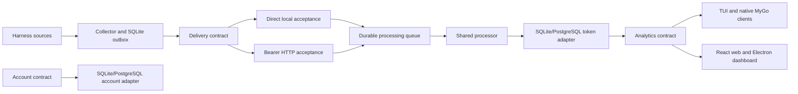

# System design

[ADR 0024](adr/0024-shared-backend-and-installable-products.md) defines composition;
[design](design.md) specifies identities, schemas, processing and query contracts.

| Composition | Lifetime | Transport | Storage |
| --- | --- | --- | --- |
| Local backend | Until final viewer disconnects | Private control and read-only HTTP; direct ingestion | Separate collector, token and application SQLite roles |
| TUI/web/MyGo/Electron | Viewer session | Semantic client; replaceable transport adapter | No viewer-owned usage storage |
| Distributed collector | Finite CLI/worker | Authenticated HTTP acceptance | Collector SQLite and operational jobs SQLite |
| Distributed server | One Docker container | Bearer ingestion/query; browser session; private admin | SQLite or PostgreSQL for paired token/account domains |

One local backend owns the token database and joins workers after the final viewer disconnects. Any viewer launcher discovers or starts it; compatible TUI, browser, MyGo and Electron sessions coexist. A foreground web command and its browser tabs have independent leases. Closing one does not terminate others. Browser streams tolerate reload through a reconnect grace. Private local operations control capture, detailed progress and maintenance; browser pages manage only their own lifetime.

The backend opens saved usage before launch-triggered capture. Identical overlapping requests coalesce; there is no periodic scan or login service. Saved history remains readable during processing and capture failures. Filters and reload query only. Distributed sync may run concurrently through the shared collector lock; its delivery progress is independent. Local machine identity describes the serving machine, not the origin of every captured fact.

Distributed sync saves a job, starts a finite worker through private config/readiness
pipes and returns after startup ACK. `--print` also submits. `--wait` ends at acceptance;
`--debug` observes its receipts through processing. The latter needs read+ingest;
ordinary sync supports ingest-only. Later explicit sync can drain earlier queued
requests for the same endpoint/credential; no daemon or reboot delivery guarantee.

Collector continuity/outbox is separate from operational jobs so network submission
cannot hold up job admission. No bearer token is saved in job rows, logs or argv.
Shutdown/interruption leaves immutable saved requests available for replay.

Account provisioning records an inactive user with a fixed dataset, idempotently
creates that dataset, then activates the user. Restart resumes pending provisioning.
Application SQLite is paired to token storage identity. There is no cross-engine transaction.

Token storage, queue and query operations remain behind contracts. A future backend
must preserve atomic acceptance/projection, dataset isolation, stable identities,
all five token components, separate estimates, revision fences and consistent query
snapshots. Equal counters do not establish identity. See [design](design.md).

Configuration is private grouped home-directory JSON: shared `collector`,
`in-process` local storage/bind and `distributed` URL/token. Flags > environment >
file > defaults. Commands select composition: TUI/Web local, sync distributed,
browse URL-only. Remote credentials never change local command behavior; failures
never fall back local. Local Web defaults to 8765, hosted server to 8766.
Personal/hosted token and account stores remain separate. Bare invocation prints
help; `data reprocess/wait` remains local maintenance. Legacy service/server/
collector commands and global mode selection are removed. Go products need no host JavaScript runtime; Electron bundles its runtime. Prebuilt releases/prereleases and shell installers replace Homebrew and Go-install publication. No compiled outputs are committed.
