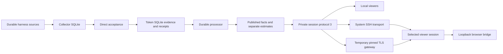

# System design

[ADR 0027](adr/0027-personal-backend-and-explicit-connections.md) defines current
composition; [design](design.md) specifies storage, identity and accounting.

| Component | Lifetime | Transport | Storage |
| --- | --- | --- | --- |
| Personal backend | Until final lease plus reconnect grace | Private Unix HTTP/2 protocol 3 | Collector 20 and token 1 SQLite |
| TUI/web/desktop | Per viewer session/window | Explicit local/SSH/TCP session | No usage storage |
| Web/desktop bridge | Caller-owned session | Loopback HTTP | None |
| Temporary remote gateway | Foreground command | Pinned TLS with ephemeral token | None |

One owner captures on launch and explicit Refresh, coalesces overlaps and opens
saved usage before capture finishes. No periodic scanning. Query reload and filters
only read. Capture failure preserves saved history; acceptance and publication are
separate atomic transactions. Pending work resumes after owner restart.

Each viewer holds a lease. Closing one leaves other viewers active; final lease
plus grace stops admission, cancels/joins work and closes stores. Bridges and the
TCP gateway own their listeners, never storage. SSH can discover/start the backend;
TCP requires its gateway and stays TCP even on the serving machine.

Desktop launch keeps credentials in a private native rendezvous and waits for
acknowledgement of the requested live session. Connection/desktop failures never
select a different transport, machine or browser.

Collector/token paths, schemas, stable IDs, evidence and receipts remain unchanged.
There are no application/account/jobs stores or migrations; retired user files stay
untouched. Native identity, five token components, separate estimates, revision
fences and snapshot-consistent queries remain enforced through semantic contracts.
Equal counters never prove duplicate consumption.
